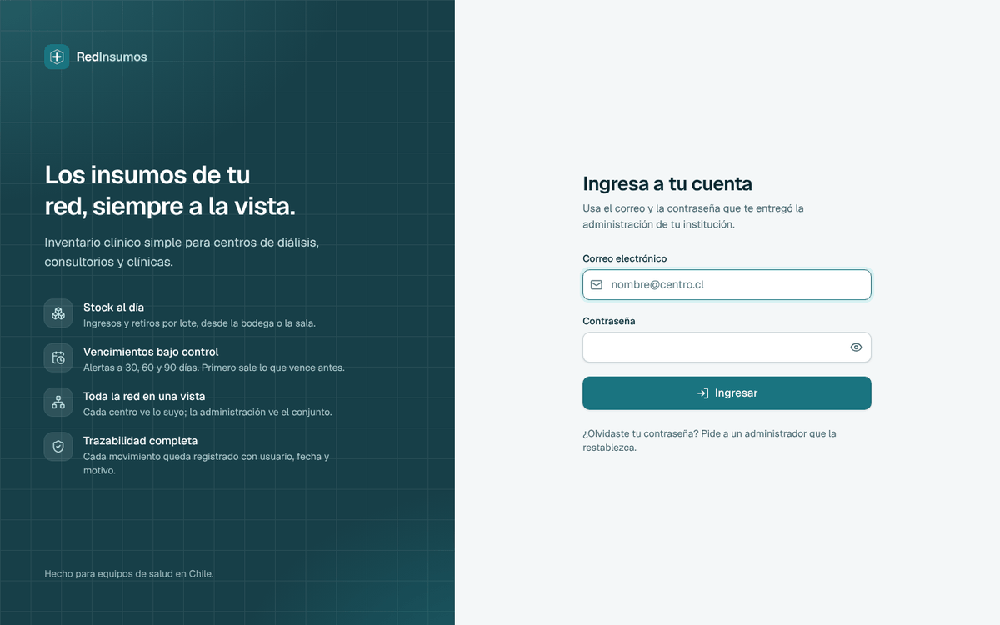
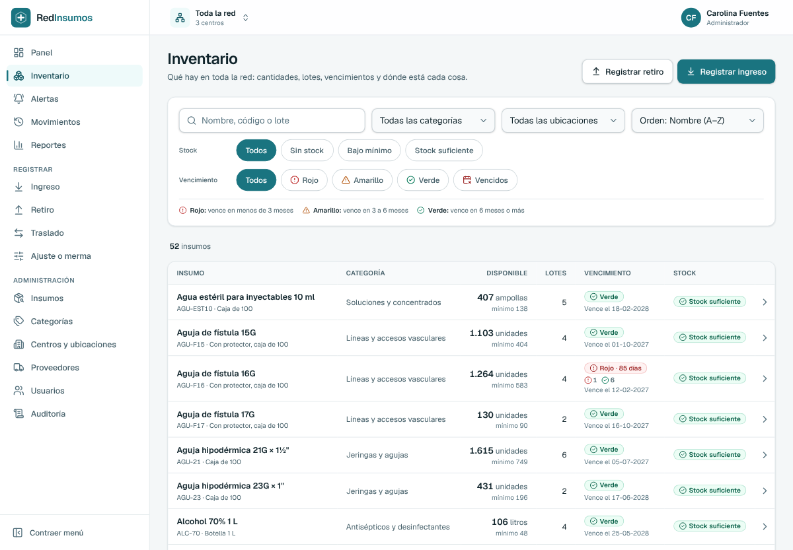
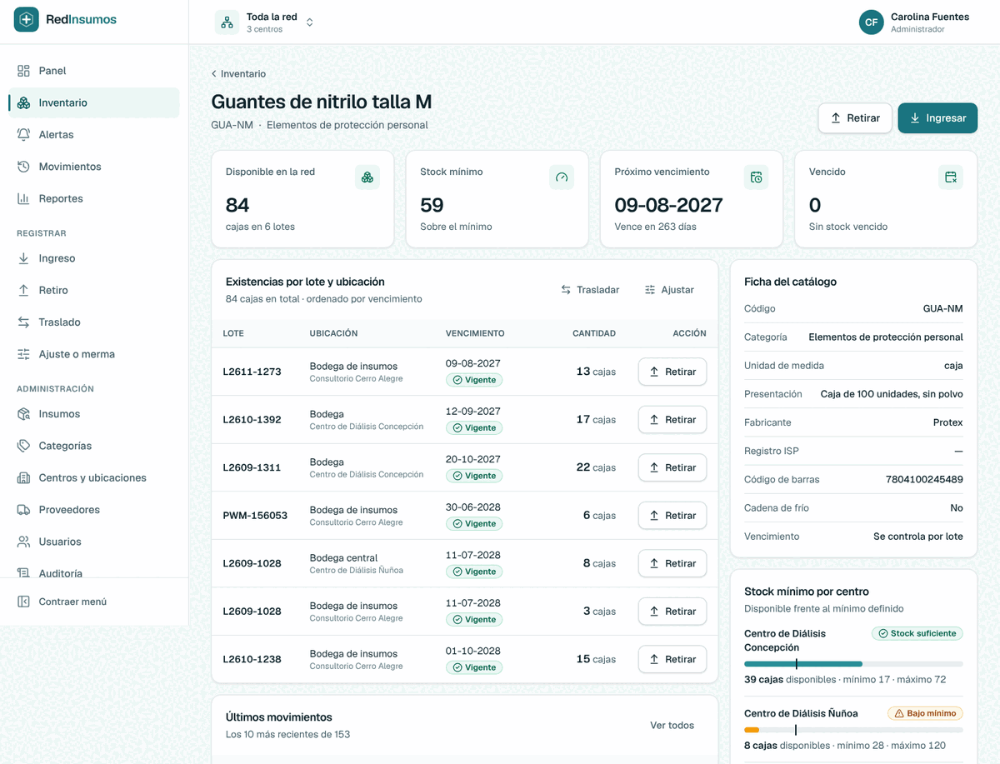
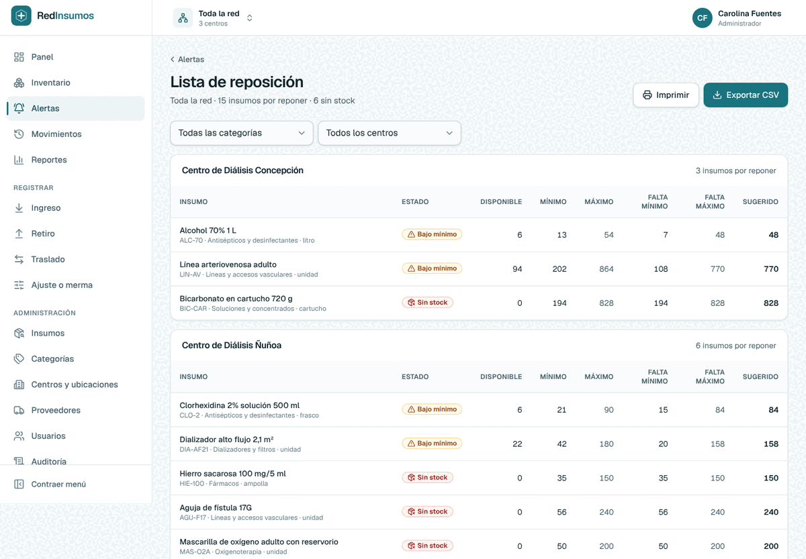
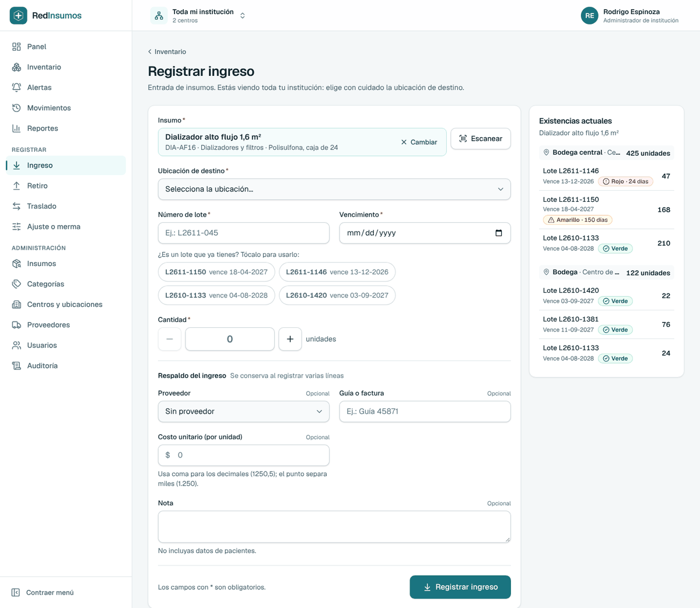
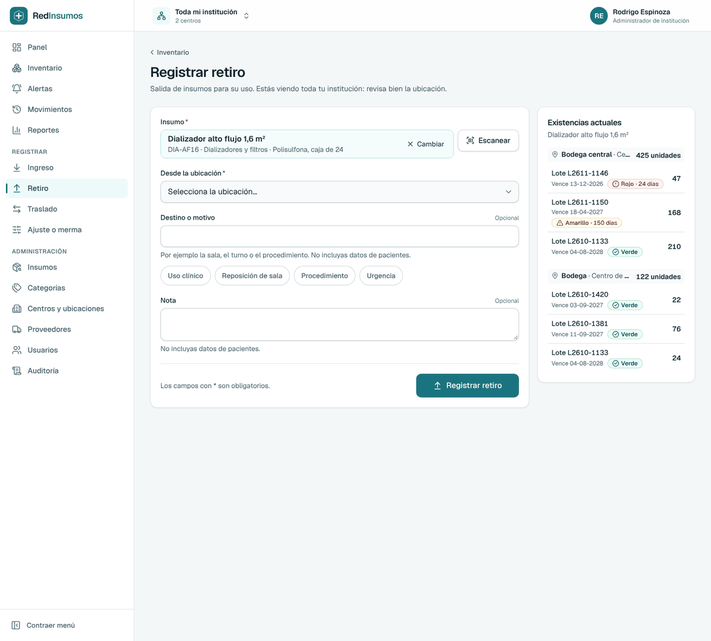
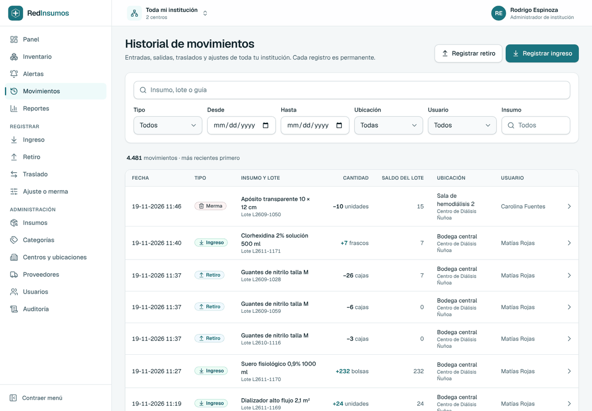
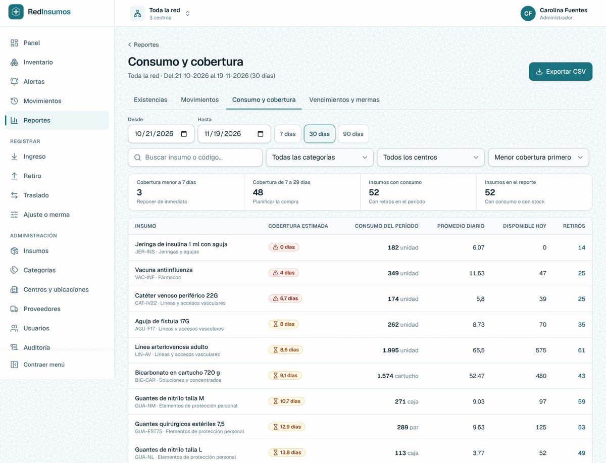
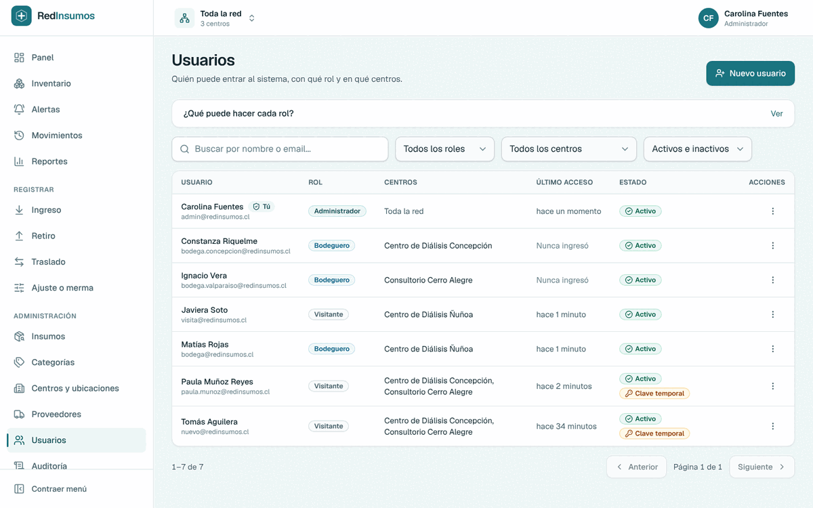

# Manual de uso de RedInsumos

Guía breve para el trabajo diario. Está organizada por rol: lee la parte común y luego la sección de
tu rol.

- [Para todos](#para-todos)
- [Visitante](#visitante) — solo consulta
- [Bodeguero](#bodeguero) — recibe y entrega insumos
- [Administrador](#administrador) — gestiona toda la red
- [Preguntas frecuentes](#preguntas-frecuentes)

> Tu rol aparece bajo tu nombre, arriba a la derecha. Si necesitas hacer algo que tu rol no permite,
> pídelo a un administrador de tu red.

---

## Para todos

### Entrar al sistema

1. Abre la dirección del sistema que te entregó tu institución, en el navegador del computador,
   tablet o teléfono.
2. Escribe tu **email** y tu **contraseña** e ingresa.
3. **La primera vez** (o después de que te restablezcan la clave) el sistema te pedirá cambiar la
   contraseña temporal por una propia. Debe tener **al menos 10 caracteres, con letras y números**,
   y ser distinta de la anterior.

Si te equivocas 5 veces seguidas, el acceso a tu cuenta desde ese lugar se bloquea por 15 minutos.
Si olvidaste tu contraseña, pide a un administrador que la restablezca: te dará una temporal, que
debes usar **dentro de 72 horas** (después vence y hay que pedir otra).

### Orientarse en la pantalla

- **Menú** (a la izquierda en el computador; abajo en el teléfono, con el resto en **Menú**): las
  secciones a las que tienes acceso.
- **Selector de centro** (arriba): si trabajas en más de un centro, elige cuál quieres ver. Los
  administradores pueden elegir además **Toda la red**.
- **Tu nombre** (arriba a la derecha): **Cambiar contraseña** y **Cerrar sesión**.

Cierra la sesión al terminar si el equipo es compartido. Por seguridad, se cierra sola tras varias
horas sin uso.

### Palabras que usa el sistema

| Palabra | Significa |
|---|---|
| **Insumo** | Un producto del catálogo (por ejemplo "Mascarilla N95"). |
| **Lote** | Una partida de ese insumo, con su número de lote y fecha de vencimiento. |
| **Ubicación** | El lugar físico dentro del centro: bodega, sala, refrigerador. |
| **Disponible** | Lo que se puede usar: el total menos lo vencido. |
| **Mínimo** | La cantidad bajo la cual conviene reponer. |
| **Ingreso / Retiro** | Entrada de insumos al centro / salida para su uso. |
| **Traslado** | Mover insumos de una ubicación a otra, o a otro centro. |
| **Ajuste** | Corregir la cantidad cuando el sistema no coincide con lo que hay físicamente. |
| **Merma** | Dar de baja insumos vencidos, dañados o perdidos. |

### Los estados y sus colores

Los estados siempre llevan texto e ícono, no solo color:

- **Stock suficiente** — hay más que el mínimo.
- **Bajo mínimo** — queda menos que el mínimo: conviene reponer.
- **Sin stock** — no queda nada utilizable.
- **Vence en N días** — el lote vence dentro de los próximos 90 días.
- **Vencido** — ya no se puede usar; hay que separarlo y darlo de baja.

---

## Visitante

Puedes **consultar** el inventario y las alertas de tus centros. No puedes registrar ni modificar
nada.

### Ver el resumen del día — *Panel*

Muestra cuántos insumos están sin stock, bajo el mínimo, vencidos o por vencer, y qué requiere
atención. Toca cualquier tarjeta o fila para ver el detalle.

### Buscar un insumo — *Inventario*

1. Entra a **Inventario**.
2. Escribe en el buscador el **nombre, código o número de lote**.
3. Si quieres, filtra por **categoría** o **ubicación**, o usa los botones **Sin stock**, **Bajo
   mínimo**, **Por vencer**, **Con vencidos** o **Stock suficiente**.
4. Toca un insumo para abrir su ficha: verás cuánto hay, **en qué ubicación está cada lote** y
   cuándo vence.

### Ver qué falta o está por vencer — *Alertas*

En **Alertas** hay cuatro pestañas: **Sin stock**, **Bajo mínimo**, **Vencidos** y **Por vencer**
(esta última separa los que vencen en 30 días o menos, de 31 a 60 y de 61 a 90).

El botón **Lista de reposición** arma el listado de lo que conviene pedir. Puedes **imprimirlo** o
descargarlo con **Exportar CSV** para abrirlo en Excel.

---

## Bodeguero

Además de consultar (todo lo del [Visitante](#visitante)), **registras lo que entra y lo que sale**
en tus centros y ves el historial de movimientos.

> Registra cada movimiento **en el momento** en que ocurre. El inventario es tan confiable como lo
> que se anota.

### Registrar un ingreso (llegan insumos)

1. Menú **Registrar → Ingreso** (o el botón **Registrar ingreso** del Panel).
2. **Insumo:** búscalo por nombre o código.
3. **Ubicación de destino:** dónde lo vas a guardar.
4. **Número de lote** y **Vencimiento:** cópialos tal como vienen en el envase. Si el lote ya
   existe, el sistema te lo sugiere: tócalo para usarlo y no tener que escribirlo.
5. **Cantidad**, en la unidad que indica el sistema (unidades, cajas, frascos…).
6. Opcional pero recomendado: **Proveedor** y **Guía o factura**. También puedes anotar el costo
   unitario y una nota.
7. Revisa el resumen al pie ("Vas a ingresar…") y presiona **Registrar ingreso**.

A la derecha ves las existencias actuales de ese insumo, para comprobar.

A tener en cuenta:

- No se pueden ingresar lotes **ya vencidos**.
- Si el insumo controla vencimiento, la fecha es obligatoria.
- Si el número de lote ya existe con **otra** fecha de vencimiento, el sistema avisa: revisa el
  envase, porque uno de los dos datos está mal.

### Registrar un retiro (salen insumos para su uso)

1. Menú **Registrar → Retiro**.
2. Elige el **insumo** y **desde qué ubicación** lo sacas. Verás cuánto hay disponible ahí.
3. **¿De qué lote sale?**
   - **Automático** (recomendado): el sistema descuenta primero lo que vence antes y te muestra de
     qué lotes saldrá. **Toma físicamente esos mismos lotes.**
   - **Elegir lote:** si necesitas sacar de un lote en particular.
4. Escribe la **cantidad**.
5. Opcional: **Destino o motivo** (por ejemplo "Reposición de sala" o "Procedimiento") y una nota.
6. Revisa el resumen y presiona **Registrar retiro**.

A tener en cuenta:

- No se puede retirar más de lo disponible.
- Los lotes **vencidos no se pueden retirar**: avisa a un administrador para que los dé de baja.

### Revisar lo registrado — *Movimientos*

En **Movimientos** (en el teléfono aparece como **Historial**) está todo lo que entró y salió en tus
centros, con fecha, usuario, lote y cantidad. Puedes filtrar y tocar un movimiento para ver su
detalle.

**¿Te equivocaste?** Los movimientos no se editan ni se borran: así el historial es confiable.
Avisa a un administrador para que haga un **ajuste** que corrija la cantidad.

---

## Administrador

Tienes acceso completo a toda la red: todo lo del [Bodeguero](#bodeguero), más traslados, ajustes y
mermas, reportes y la administración del sistema.

### Revisar la red cada día — *Panel*

Con **Toda la red** seleccionada arriba, el Panel reúne lo que requiere atención en todos los
centros, en orden de prioridad: insumos sin stock, vencidos por dar de baja, bajo el mínimo y por
vencer. Cada bloque trae el botón para resolverlo (por ejemplo **Registrar ingreso** o **Registrar
merma**). Cambia el selector para ver un solo centro.

### Trasladar insumos

Menú **Registrar → Traslado**. Elige el insumo y el lote, la ubicación de **origen**, la de
**destino** (puede ser de otro centro) y la cantidad. El sistema registra la salida y la entrada
juntas. Sirve también para mover lotes vencidos a un lugar apartado mientras se dan de baja.

### Corregir el stock o dar de baja — *Ajuste o merma*

Menú **Registrar → Ajuste o merma**. Elige una opción:

| Opción | Cuándo usarla |
|---|---|
| **Sumar stock** | Hay **más** de lo que dice el sistema. |
| **Restar stock** | Hay **menos** de lo que dice el sistema. |
| **Dar de baja** (merma) | El insumo está vencido, dañado, contaminado, perdió la cadena de frío o se extravió. |

Indica insumo, ubicación, lote, cantidad y el **motivo** (obligatorio; por ejemplo "Conteo de
inventario" o "Vencimiento"). Todo ajuste queda en el historial y en la auditoría con tu nombre.

Dar de baja es la **única** forma de sacar del inventario un lote vencido.

### Reportes

En **Reportes** hay cuatro, cada uno con vista previa y descarga para Excel (CSV) según los filtros
que apliques:

- **Existencias:** stock actual valorizado por centro, ubicación y lote.
- **Movimientos:** ingresos, retiros, ajustes, mermas y traslados de un período.
- **Consumo y cobertura:** cuánto se retira de cada insumo, el promedio diario y para cuántos días
  alcanza lo que hay.
- **Vencimientos y mermas:** lotes vencidos o por vencer y las bajas del período.

### Administración

En el menú **Administración**:

| Sección | Para qué |
|---|---|
| **Insumos** | El catálogo común a toda la red: código, nombre, categoría, unidad de medida, si controla vencimiento o requiere cadena de frío y, opcionalmente, su registro sanitario. En la ficha de cada insumo defines el **stock mínimo y máximo por centro**, que es lo que activa las alertas. |
| **Categorías** | Los grupos en que se ordenan los insumos. |
| **Centros y ubicaciones** | Los establecimientos de la red y los lugares donde cada uno guarda su stock (bodegas, salas, refrigeradores). |
| **Proveedores** | A quiénes se les compra, para indicarlos en los ingresos. |
| **Usuarios** | Quién puede entrar, con qué rol y en qué centros. |
| **Auditoría** | Registro de quién hizo qué y cuándo. Solo lectura. |

Lo que tiene historial **no se elimina, se desactiva**: un insumo, centro, ubicación, proveedor o
usuario desactivado deja de usarse pero sus registros se conservan.

### Usuarios

- **Crear:** botón **Nuevo usuario**. Indica nombre, email, rol y centros. El sistema muestra una
  **contraseña temporal una sola vez**: entrégasela a la persona por un medio seguro. Deberá
  cambiarla al entrar, y tiene **72 horas** para hacerlo: después la temporal vence y hay que
  restablecerla.
- **Menú ⋮ de cada usuario:**
  - **Editar datos, rol y centros.**
  - **Restablecer contraseña:** genera una nueva temporal, válida por 72 horas (para quien olvidó
    la suya o dejó vencer la anterior).
  - **Desbloquear cuenta:** si quedó bloqueada por intentos fallidos.
  - **Desactivar usuario:** para quien ya no debe entrar; queda fuera de inmediato. Se puede
    reactivar después.

Buenas prácticas: una cuenta por persona (nunca compartidas), el rol más limitado que le permita
hacer su trabajo, y al menos dos administradores en la red. El detalle de estas tareas está en
[`OPERACION.md`](OPERACION.md#usuarios).

### Auditoría

**Administración → Auditoría** lista los ingresos al sistema, los movimientos de stock y los
cambios de administración, con filtros. Abre un registro para ver su detalle. Conviene revisarla
periódicamente, en especial los ajustes, las mermas y los intentos de ingreso fallidos.

### Poner en marcha un centro nuevo (orden sugerido)

1. **Centros y ubicaciones:** crea el centro y sus ubicaciones.
2. **Categorías** e **Insumos:** revisa que el catálogo tenga lo que el centro usa.
3. En cada insumo, define el **mínimo** para ese centro.
4. **Proveedores:** agrega los que falten.
5. **Usuarios:** crea las cuentas del personal y asígnales el centro.
6. Carga el stock inicial: con **ingresos** (si hay guía o factura) o con **Ajuste → Sumar stock**
   y motivo "Stock inicial".

---

## Preguntas frecuentes

**Olvidé mi contraseña.** Pide a un administrador que la restablezca. No hay recuperación por
correo.

**Me dice "Email o contraseña incorrectos" y estoy seguro de la clave.** Puede que la cuenta esté
bloqueada por intentos fallidos (espera 15 minutos o pide que la desbloqueen), desactivada, o que
tu contraseña temporal haya vencido (pide que te la restablezcan).

**No veo un centro o un botón que otro compañero sí ve.** Depende del rol y de los centros
asignados a cada persona. Consulta a un administrador.

**Registré mal un movimiento.** No se puede editar ni borrar. Un administrador lo corrige con un
ajuste, indicando el motivo.

**El sistema dice que hay stock, pero no lo encuentro.** Revisa en la ficha del insumo en qué
ubicación y lote figura. Si realmente no está, avisa a un administrador para que lo ajuste.

**¿Puedo usarlo en el teléfono?** Sí, en el navegador. El menú principal queda abajo y el resto en
**Menú**.

**¿Se guardan datos de pacientes?** No. RedInsumos registra insumos y movimientos. **No escribas
nombres, RUT ni datos de pacientes** en las notas o motivos.
