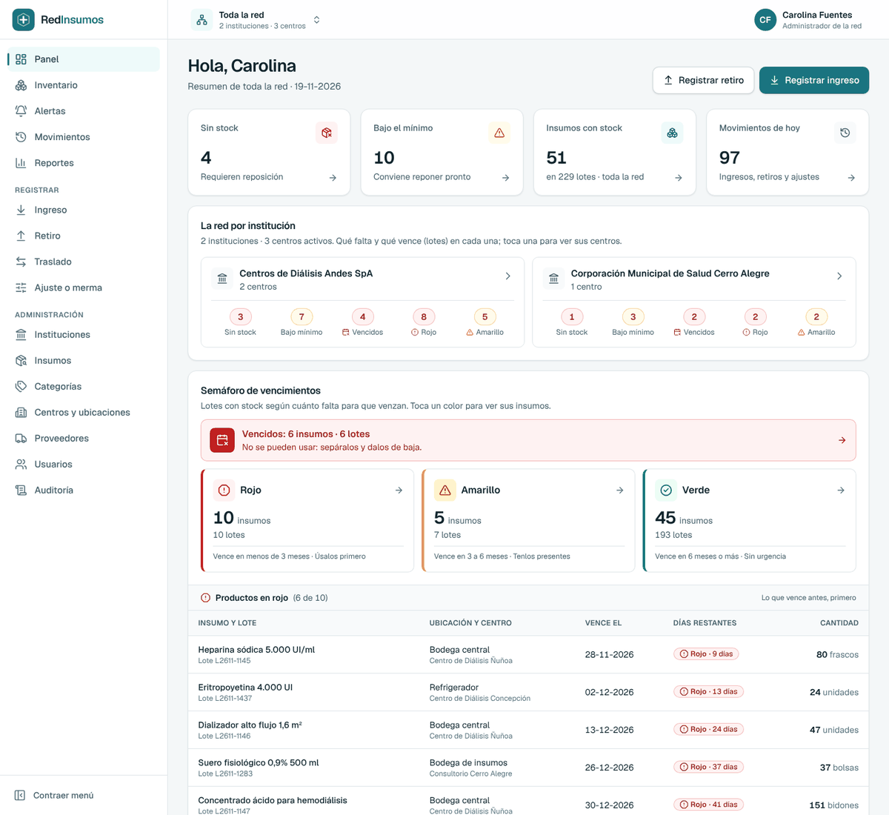
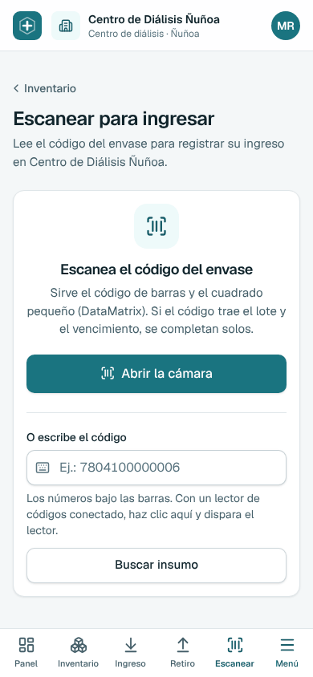
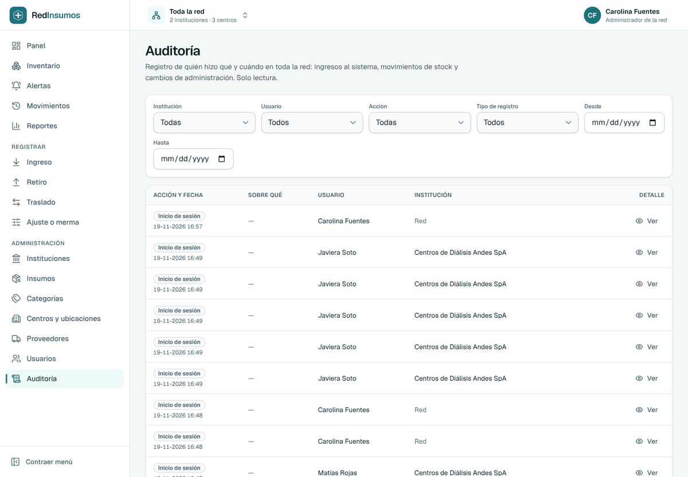

# Manual de uso de RedInsumos

Guía breve para el trabajo diario. Está organizada por rol: lee la parte común y luego la sección de
tu rol.

- [Para todos](#para-todos)
- [Visitante](#visitante) — solo consulta
- [Bodeguero](#bodeguero) — recibe y entrega insumos
- [Administrador de institución](#administrador-de-institución) — gestiona su institución
- [Administrador de la red](#administrador-de-la-red) — gestiona todas las instituciones
- [Preguntas frecuentes](#preguntas-frecuentes)

> Tu rol aparece bajo tu nombre, arriba a la derecha. Si necesitas hacer algo que tu rol no permite,
> pídelo a un administrador de tu institución.

**Instituciones y centros.** La red reúne a varias instituciones (por ejemplo, una empresa de
diálisis y una corporación municipal). Cada institución tiene sus propios centros y usuarios, y
**no ve nada de las demás**. Tu institución aparece en el menú de tu nombre.

---

## Para todos

### Entrar al sistema

1. Abre la dirección del sistema que te entregó tu institución, en el navegador del computador,
   tablet o teléfono.
2. Escribe tu **correo electrónico** y tu **contraseña** e ingresa.
3. **La primera vez** (o después de que te restablezcan la clave) el sistema te pedirá cambiar la
   contraseña temporal por una propia. Debe tener **al menos 10 caracteres, con letras y números**,
   y ser distinta de la anterior.

Si te equivocas 5 veces seguidas, el acceso a tu cuenta desde ese lugar se bloquea por 15 minutos.
Si olvidaste tu contraseña, pide a un administrador que la restablezca: te dará una temporal, que
debes usar **dentro de 72 horas** (después vence y hay que pedir otra).

### Orientarse en la pantalla

- **Menú**: las secciones a las que tienes acceso. En el computador está a la izquierda; en una
  tablet horizontal se reduce a una columna de íconos (el botón de abajo lo abre completo); en el
  teléfono queda abajo, con el resto en **Menú**.
- **Selector de centro** (arriba): si trabajas en más de un centro, elige cuál quieres ver. Los
  administradores pueden elegir además todos sus centros a la vez: **Toda mi institución** (o
  **Toda la red**, el administrador de la red).
- **Tu nombre** (arriba a la derecha): **Cambiar contraseña**, **Ayuda** y **Salir**.

Cierra la sesión al terminar si el equipo es compartido. Por seguridad, se cierra sola tras varias
horas sin uso: si eso pasa mientras llenas un formulario, verás el aviso **Tu sesión venció** y el
sistema te llevará a ingresar de nuevo y de vuelta a la misma pantalla (lo que no alcanzaste a
registrar hay que escribirlo otra vez).

Si aparece **“No tienes un centro activo asignado”**, tu cuenta no está asignada a ningún centro en
funcionamiento: pide a un administrador que te asigne uno.

### Instalarlo en la tablet o el teléfono

RedInsumos se puede dejar como una aplicación más del equipo, con su ícono y a pantalla completa:

- **Android (Chrome) o computador (Chrome/Edge):** menú del navegador → **Instalar aplicación** o
  **Agregar a la pantalla principal**.
- **iPad o iPhone (Safari):** botón **Compartir** → **Agregar a inicio**.

Sigue necesitando conexión a internet: no funciona sin red.

### Palabras que usa el sistema

| Palabra | Significa |
|---|---|
| **Insumo** | Un producto del catálogo (por ejemplo "Mascarilla N95"). |
| **Lote** | Una partida de ese insumo, con su número de lote y fecha de vencimiento. |
| **Ubicación** | El lugar físico dentro del centro: bodega, sala, refrigerador. |
| **Disponible** | Lo que se puede usar: el total menos lo vencido. |
| **Mínimo** | La cantidad bajo la cual conviene reponer. |
| **Ingreso / Retiro** | Entrada de insumos al centro / salida para su uso. |
| **Traslado** | Mover insumos de una ubicación a otra, o a otro centro. |
| **Ajuste** | Corregir la cantidad cuando el sistema no coincide con lo que hay físicamente. |
| **Merma** | Dar de baja insumos vencidos, dañados o perdidos. |

### Los estados y sus colores

Los estados siempre llevan texto e ícono, no solo color:

- **Stock suficiente** — hay más que el mínimo.
- **Bajo mínimo** — queda menos que el mínimo: conviene reponer.
- **Sin stock** — no queda nada utilizable.
- **Vencido** — ya no se puede usar; hay que separarlo y darlo de baja.

### El semáforo de vencimiento

Cada lote tiene un color según **cuánto falta para que venza**. Es el mismo en toda la aplicación
(panel, inventario, alertas, formularios y reportes):

| Color | Forma | Significa | Qué hacer |
|---|---|---|---|
| **Rojo** | Octágono | Vence en **menos de 3 meses** | Úsalo primero para que no se pierda. |
| **Amarillo** | Triángulo | Vence en **3 a 6 meses** | Tenlo presente al planificar el consumo y las compras. |
| **Verde** | Círculo | Vence en **6 meses o más** | Sin urgencia. |
| **Vencido** | Calendario tachado | **Ya venció** (aparte del semáforo y más grave que el rojo) | No se usa ni se retira: se separa y un administrador lo da de baja. |
| **Sin vencimiento** | ∞ | El insumo no lleva fecha de vencimiento | — |

- Los meses se cuentan **por calendario** desde hoy: si hoy es 19 de noviembre, es rojo lo que vence
  antes del 19 de febrero, amarillo lo que vence desde el 19 de febrero y antes del 19 de mayo, y
  verde lo que vence desde el 19 de mayo. El día del vencimiento el lote todavía se puede usar.
- Cada color lleva además **una forma distinta y su nombre escrito** («Rojo · 12 días»): se
  distingue aunque no veas bien los colores o imprimas en blanco y negro.
- El color de un **insumo** es el de su lote con stock que vence antes (el peor). Si tiene lotes de
  varios colores, al lado se muestra cuántos hay de cada uno.
- Un lote guardado en dos ubicaciones se cuenta en cada una.

---

## Visitante

Puedes **consultar** el inventario y las alertas de tus centros. No puedes registrar ni modificar
nada.

### Ver el resumen del día — *Panel*

De arriba abajo:

1. **Qué falta:** cuántos insumos están sin stock o bajo el mínimo.
2. **Semáforo de vencimientos:** tres tarjetas grandes —**Rojo**, **Amarillo** y **Verde**— con el
   número de insumos y de lotes de cada color; tócalas para ver esos insumos en el inventario. Si
   hay lotes **vencidos**, aparecen destacados arriba. Debajo está la lista de **productos en rojo**
   (insumo, lote, ubicación, fecha y días que le quedan), ordenada por lo que vence antes: toca una
   fila para abrir la ficha del insumo, o **Ver todos los lotes en rojo**.
3. **Qué requiere atención hoy**, en orden de prioridad.
4. **Proveedores:** dónde comprar y a quién llamar (ver más abajo).

### Ver los proveedores y dónde comprar

En el Panel, la sección **Proveedores** lista a quienes abastecen a la red (primero los que más se
han usado en los ingresos de tu centro):

- **Ir a comprar** abre el sitio web del proveedor en otra pestaña. Bajo el nombre se ve la dirección
  a la que lleva. Si el proveedor no tiene sitio registrado, el botón no aparece.
- Toca el nombre para **desplegar** su teléfono, su correo, la persona de contacto y el RUT. Desde el
  celular, tocar el teléfono inicia la llamada y tocar el correo abre tu aplicación de correo.
- **Ver todos** abre el directorio completo, con buscador.
- Al desplegar un proveedor, **Insumos que le compras** dice cuántos insumos de tu inventario lo
  tienen como proveedor y abre el Inventario filtrado por él.

### El proveedor de cada insumo

Cada insumo tiene **su proveedor**, y lo ves donde lo necesitas (todos los roles):

- **Inventario:** columna **Proveedor** de la grilla (en pantallas angostas, bajo el nombre del
  insumo) y filtro **Proveedor** en la barra de filtros (incluye «Sin proveedor definido»). Al abrir
  un insumo, el panel lateral trae el bloque **Proveedor** con **Ir a comprar**, teléfono y correo.
- **Ficha del insumo:** tarjeta **Proveedor** con los mismos datos.
- **Alertas** (pestañas *Sin stock* y *Bajo mínimo*) y **Qué requiere atención hoy** del Panel:
  el proveedor junto al insumo y el enlace **Ir a comprar** si tiene sitio web.
- **Lista de reposición:** columna Proveedor y la opción **Agrupar por → Proveedor**, que arma un
  bloque por distribuidor (con su teléfono y correo en el encabezado, también en la hoja impresa)
  para hacer un pedido a cada uno. El CSV trae proveedor, RUT, teléfono y correo.
- **Registrar ingreso:** al elegir el insumo (a mano o con el escáner) el campo Proveedor llega con
  su proveedor ya elegido. Puedes cambiarlo para ese ingreso: **registrar con otro proveedor no
  cambia el proveedor del insumo**.

Cómo se decide cuál es: como el catálogo es compartido, hay un **proveedor predeterminado de la
red** (lo define el administrador de la red) y cada institución puede tener **su propio proveedor**
para un insumo, que vale solo para ella. Ves siempre el de tu institución si existe; si no, el de la
red; y si ninguno está definido, «Sin proveedor». En ese caso la ficha muestra el **último
proveedor** al que se le ingresó ese insumo en tus centros, rotulado como tal (es solo una pista).
Un proveedor **desactivado** que sigue asignado se muestra marcado «Inactivo».

**Definir o cambiar el proveedor de un insumo** (administradores):

1. Abre la ficha del insumo y, en la tarjeta **Proveedor**, presiona **Cambiar proveedor** (o
   **Definir proveedor**).
2. Elige el proveedor (puedes buscarlo por nombre o RUT; solo aparecen los activos).
3. Revisa el recuadro que indica **qué cambias**:
   - *Administrador de institución:* «Cambias el proveedor **para tu institución**». Las demás
     instituciones y el predeterminado de la red no cambian.
   - *Administrador de la red:* eliges entre el **predeterminado de la red** o **solo para una
     institución** (y cuál).
4. **Continuar**, revisa «Hoy / Quedará» y **Confirmar cambio**. Queda en la auditoría.
5. Para dejar el proveedor propio de tu institución: **Volver al predeterminado de la red**.

También desde **Administración → Insumos**: al **crear** un insumo puedes indicar su «Proveedor
predeterminado» (queda para toda la red); al **editarlo**, el administrador de la red cambia ese
campo y el administrador de institución usa la sección **Proveedor de tu institución**, junto a los
mínimos y máximos. Cuando el insumo no tiene proveedor y la ficha muestra el del último ingreso,
**Usar como predeterminado** lo deja definido en un paso.

### Buscar un insumo — *Inventario*

1. Entra a **Inventario**.
2. Escribe en el buscador el **nombre, código o número de lote**.
3. Si quieres, filtra por **categoría** o **ubicación**, por estado de stock (**Sin stock**, **Bajo
   mínimo**, **Stock suficiente**) o por el semáforo de vencimiento (**Rojo**, **Amarillo**,
   **Verde**, **Vencidos**). El filtro de color muestra los insumos que tienen **algún** lote de ese
   color.
4. Toca un insumo para abrir su ficha: verás cuánto hay, **en qué ubicación está cada lote**,
   cuándo vence y su color.

### Ver qué falta o está por vencer — *Alertas*

En **Alertas** hay cinco pestañas: **Sin stock**, **Bajo mínimo**, **Vencidos**, **Rojo** (lotes
que vencen en menos de 3 meses) y **Amarillo** (de 3 a 6 meses). Lo que está en verde no es una
alerta: se consulta en Inventario con el filtro **Verde**.

Cada fila trae, a la derecha, la acción que tu rol puede hacer (un visitante solo consulta):
**Ingresar** lo que falta, **Retirar** primero el lote en rojo o amarillo o **Dar de baja** un lote
vencido. El formulario se abre con el insumo, la ubicación y el lote ya elegidos.

El botón **Lista de reposición** arma el listado de lo que conviene pedir. Puedes **imprimirlo** o
descargarlo con **Exportar CSV** para abrirlo en Excel.

---

## Bodeguero

Además de consultar (todo lo del [Visitante](#visitante)), **registras lo que entra y lo que sale**
en tus centros y ves el historial de movimientos.

> Registra cada movimiento **en el momento** en que ocurre. El inventario es tan confiable como lo
> que se anota.

### Ingresar un producto escaneando su código (celular)

1. En el celular, toca **Escanear** en el Panel (el botón grande de arriba) o en la barra inferior.
   La primera vez, el navegador pide permiso para usar la cámara: **acéptalo**.
2. Apunta al **código de barras** o al **cuadrado pequeño (DataMatrix)** del envase, dentro del
   marco. Con poca luz, enciende la **linterna** (aparece si tu teléfono la permite).
3. Si el sistema reconoce el código, abre el ingreso con el **insumo ya elegido**. Cuando el código
   trae el **lote** y el **vencimiento** (lo habitual en los DataMatrix de insumos médicos), también
   quedan completos: **revísalos contra el envase**.
4. Escribe la **cantidad** y presiona **Registrar ingreso**.

Si algo no resulta:

- **La cámara no lee el código:** usa **Escribir el código** (abajo en el escáner) y copia los
  números que aparecen bajo las barras. Un lector de códigos conectado al computador (USB o
  Bluetooth) funciona igual: haz clic en ese campo y dispara el lector.
- **«No reconocemos este código»:** ningún insumo del catálogo lo tiene registrado. Busca el insumo
  por su nombre y continúa con el ingreso (el lote y el vencimiento leídos se conservan). Para que
  la próxima vez se reconozca: el **administrador de la red** puede asociarlo ahí mismo con
  **Asociar este código a ese insumo**; el **administrador de institución** puede **Crear insumo
  con este código** si el insumo aún no existe, pero para asociarlo a uno que ya existe debe pedirlo
  al administrador de la red (el catálogo es compartido por todas las instituciones). El bodeguero
  lo pide a su administrador.
- **«Falta el permiso para usar la cámara»:** toca el candado junto a la dirección del sitio (en
  iPhone, «aA»), deja la cámara en *Permitir* y vuelve a intentarlo.
- **«La cámara necesita una conexión segura»:** el sitio no se abrió con HTTPS. Avisa a quien
  administra el sistema.

También hay un botón **Escanear** junto al buscador de insumos en los formularios de ingreso y de
retiro.

### Registrar un ingreso (llegan insumos)

1. Menú **Registrar → Ingreso** (o el botón **Registrar ingreso** del Panel).
2. **Insumo:** búscalo por nombre o código, o toca **Escanear** y lee el código del envase.
3. **Ubicación de destino:** dónde lo vas a guardar.
4. **Número de lote** y **Vencimiento:** cópialos tal como vienen en el envase. Si el lote ya
   existe en tu centro, el sistema te lo sugiere: tócalo para usarlo y no tener que escribirlo (la
   fecha ya registrada se conserva).
5. **Cantidad**, en la unidad que indica el sistema (unidades, cajas, frascos…).
6. Opcional pero recomendado: **Proveedor** y **Guía o factura**. También puedes anotar el **costo
   unitario** y una nota. En el costo usa **coma para los decimales** (`1250,5`); el punto separa
   miles (`1.250`). Bajo el campo se muestra el monto tal como se guardará: revísalo, porque los
   movimientos no se pueden corregir después.
7. Revisa el resumen al pie ("Vas a ingresar…") y presiona **Registrar ingreso**.

A la derecha ves las existencias actuales de ese insumo, para comprobar.

A tener en cuenta:

- No se pueden ingresar lotes **ya vencidos**.
- Si el insumo controla vencimiento, la fecha es obligatoria.
- Si el número de lote ya existe con **otra** fecha de vencimiento, el sistema avisa: revisa el
  envase, porque uno de los dos datos está mal. Si la fecha registrada es la equivocada, un
  administrador puede corregirla.
- En las notas y motivos **no escribas datos de pacientes**.

### Registrar un retiro (salen insumos para su uso)

1. Menú **Registrar → Retiro**.
2. Elige el **insumo** (al abrir el buscador aparecen primero los **más usados en este centro**) y
   **desde qué ubicación** lo sacas. Verás cuánto hay disponible ahí.
3. **¿De qué lote sale?**
   - **Automático** (recomendado): el sistema descuenta primero lo que vence antes y te muestra de
     qué lotes saldrá. **Toma físicamente esos mismos lotes.**
   - **Elegir lote:** si necesitas sacar de un lote en particular.
4. Escribe la **cantidad**.
5. Opcional: **Destino o motivo** (por ejemplo "Reposición de sala" o "Procedimiento") y una nota.
6. Revisa el resumen y presiona **Registrar retiro**. Si vas a sacar **más de la mitad** de lo
   disponible en esa ubicación, el sistema te pide confirmar antes de registrar.

A tener en cuenta:

- No se puede retirar más de lo disponible.
- Los lotes **vencidos no se pueden retirar**: avisa a un administrador para que los dé de baja.

### Revisar lo registrado — *Movimientos*

En **Movimientos** (en el teléfono aparece como **Historial**) está todo lo que entró y salió en tus
centros, con fecha, usuario, lote y cantidad. Puedes filtrar y tocar un movimiento para ver su
detalle.

**¿Te equivocaste?** Los movimientos no se editan ni se borran: así el historial es confiable.
Avisa a un administrador para que haga un **ajuste** que corrija la cantidad.

---

## Administrador de institución

Tienes acceso completo a **tu institución**: todo lo del [Bodeguero](#bodeguero) en cualquiera de
sus centros (sin que te los asignen uno a uno), más traslados, ajustes y mermas, reportes y la
administración de tu institución. No ves centros, usuarios, stock ni auditoría de otras
instituciones.

### Revisar tu institución cada día — *Panel*

Con **Toda mi institución** seleccionada arriba, el Panel reúne lo que requiere atención en todos
tus centros, en orden de prioridad: insumos sin stock, lotes vencidos por dar de baja y lo que vence
esta semana. Cada fila trae el botón para resolverlo (**Ingresar**, **Dar de baja** o **Retirar**).
El gráfico **Actividad de los últimos 14 días** muestra cuántos movimientos de entrada y de salida
se registraron cada día (cuenta movimientos, no unidades). Cambia el selector para ver un solo
centro.

### Trasladar insumos

Menú **Registrar → Traslado**. Elige el insumo y el lote, la ubicación de **origen**, la de
**destino** (puede ser de otro centro de tu institución; no se traslada entre instituciones) y la
cantidad. El sistema registra la salida y la entrada
juntas. Sirve también para mover lotes vencidos a un lugar apartado mientras se dan de baja.

### Corregir el stock o dar de baja — *Ajuste o merma*

Menú **Registrar → Ajuste o merma**. Elige una opción:

| Opción | Cuándo usarla |
|---|---|
| **Sumar stock** | Hay **más** de lo que dice el sistema. |
| **Restar stock** | Hay **menos** de lo que dice el sistema. |
| **Dar de baja** (merma) | El insumo está vencido, dañado, contaminado, perdió la cadena de frío o se extravió. |

Indica insumo, ubicación, lote, cantidad y el **motivo** (obligatorio; por ejemplo "Conteo de
inventario" o "Vencimiento"). Antes de registrar, el sistema muestra un resumen y **pide
confirmar**: un ajuste o una merma no se pueden editar ni borrar (un error se corrige con otro
ajuste). Todo queda en el historial y en la auditoría con tu nombre.

Dar de baja es la **única** forma de sacar del inventario un lote vencido.

### Corregir el vencimiento de un lote

Si la fecha de vencimiento de un lote se digitó mal, abre la **ficha completa** del insumo (desde
Inventario) y, en la tabla **Existencias por lote y ubicación**, usa **Corregir vencimiento**.
Indica la fecha correcta y el motivo, revisa el antes y el después y confirma.

La fecha es del lote: cambia en **todas** las ubicaciones y centros donde esté, y puede dejarlo
vencido o vigente. Queda en la auditoría con tu nombre, la fecha anterior, la nueva y el motivo.
Si el mismo lote también tiene existencias en otra institución, solo puede corregirlo el
administrador de la red.

### Reportes

En **Reportes** hay cuatro, cada uno con vista previa y descarga para Excel (CSV) según los filtros
que apliques:

- **Existencias:** stock actual valorizado por centro, ubicación y lote.
- **Movimientos:** ingresos, retiros, ajustes, mermas y traslados de un período.
- **Consumo y cobertura:** cuánto se retira de cada insumo, el promedio diario y para cuántos días
  alcanza lo que hay.
- **Vencimientos y mermas:** lotes por color del semáforo (por defecto vencidos, rojo y amarillo;
  se puede filtrar por un color) y las bajas del período.

Los reportes de existencias y de vencimientos tienen el filtro **Semáforo**, y sus archivos para
Excel traen la columna «Semáforo» con el texto *Rojo*, *Amarillo*, *Verde*, *Vencido* o
*Sin vencimiento*.

### Administración

En el menú **Administración**:

| Sección | Para qué |
|---|---|
| **Insumos** | El catálogo **compartido por toda la red**: código, nombre, categoría, unidad de medida, si controla vencimiento o requiere cadena de frío y, opcionalmente, su registro sanitario. Puedes **crear insumos nuevos** (con su proveedor predeterminado) y, en la ficha de cada insumo, definir el **stock mínimo y máximo de tus centros**, que es lo que activa las alertas, y el **proveedor de tu institución** para ese insumo. No puedes modificar ni desactivar un insumo que ya existe (lo usan otras instituciones): pídeselo al administrador de la red. |
| **Categorías** | Los grupos en que se ordenan los insumos. Puedes crear categorías nuevas; renombrar o eliminar las existentes es del administrador de la red. |
| **Centros y ubicaciones** | Los establecimientos de tu institución y los lugares donde cada uno guarda su stock (bodegas, salas, refrigeradores). Puedes crear, editar y desactivar tus centros. |
| **Proveedores** | A quiénes se les compra: RUT, razón social, contacto, teléfono, correo y **sitio web (para comprar)**. Se indican en los ingresos y aparecen en el Panel de todos los roles con el botón «Ir a comprar». Se pueden crear, editar, desactivar y reactivar. Son compartidos por toda la red. |
| **Usuarios** | Quién puede entrar en tu institución, con qué rol y en qué centros. |
| **Auditoría** | Registro de quién hizo qué y cuándo en tu institución. Solo lectura. |

Lo que tiene historial **no se elimina, se desactiva**: un insumo, centro, ubicación, proveedor o
usuario desactivado deja de usarse pero sus registros se conservan.

### Usuarios

- **Roles que puedes asignar:** **Administrador de institución** (otro administrador de tu
  institución; ve todos sus centros), **Bodeguero** y **Visitante** (solo los centros que les
  marques, siempre de tu institución). No puedes crear administradores de la red ni usuarios de
  otra institución, y un usuario no se cambia de institución.
- **Crear:** botón **Nuevo usuario**. Indica nombre, correo electrónico, rol y centros. El sistema muestra una
  **contraseña temporal una sola vez**: entrégasela a la persona por un medio seguro. Deberá
  cambiarla al entrar, y tiene **72 horas** para hacerlo: después la temporal vence y hay que
  restablecerla.
- **Estado de la contraseña temporal:** en la lista, quien aún no la cambia aparece con
  **Contraseña temporal vence el dd-mm-aaaa**. Si la dejó vencer, aparece **Contraseña temporal
  vencida** con el botón **Restablecer** ahí mismo: no puede entrar hasta que generes otra.
- **Menú ⋮ de cada usuario:**
  - **Editar datos, rol y centros.**
  - **Restablecer contraseña:** genera una nueva temporal, válida por 72 horas (para quien olvidó
    la suya o dejó vencer la anterior).
  - **Desbloquear cuenta:** si quedó bloqueada por intentos fallidos.
  - **Desactivar usuario:** para quien ya no debe entrar; queda fuera de inmediato. Se puede
    reactivar después.

Buenas prácticas: una cuenta por persona (nunca compartidas), el rol más limitado que le permita
hacer su trabajo, y al menos dos administradores en cada institución. El detalle de estas tareas está en
[`OPERACION.md`](OPERACION.md#usuarios).

### Auditoría

**Administración → Auditoría** lista los ingresos al sistema, los movimientos de stock y los
cambios de administración, con filtros. Abre un registro para ver su detalle. Conviene revisarla
periódicamente, en especial los ajustes, las mermas y los intentos de ingreso fallidos.

### Poner en marcha un centro nuevo (orden sugerido)

1. **Centros y ubicaciones:** crea el centro y sus ubicaciones.
2. **Categorías** e **Insumos:** revisa que el catálogo tenga lo que el centro usa.
3. En cada insumo, define el **mínimo** para ese centro.
4. **Proveedores:** agrega los que falten.
5. **Usuarios:** crea las cuentas del personal y asígnales el centro.
6. Carga el stock inicial: con **ingresos** (si hay guía o factura) o con **Ajuste → Sumar stock**
   y motivo "Stock inicial".

---

## Administrador de la red

Operas la plataforma: tienes todo lo del [Administrador de institución](#administrador-de-institución),
pero en **todas** las instituciones, y además:

### Ver el complejo total — *Panel*

Con **Toda la red** seleccionada arriba, el Panel muestra **La red por institución**: una tarjeta
por institución con su número de centros, cuántos insumos tiene sin stock y bajo el mínimo, y su
**semáforo de vencimientos**: cuántos lotes vencidos, en rojo y en amarillo. Haz clic en una
institución para ver el detalle de sus centros; cada número lleva a las Alertas de ese centro, en
la pestaña que corresponde. Más abajo sigue el semáforo de toda la red, con los productos en rojo.
El selector de centro agrupa los centros por institución.

### Instituciones

**Administración → Instituciones** lista las instituciones con sus centros, usuarios y stock.

- **Nueva institución:** indica el nombre (y el RUT, si lo tienes). Deja marcado **Crear a su
  primer administrador** e indica su nombre y correo: verás **una sola vez** su contraseña
  temporal (válida 72 horas) para entregársela. Con esa cuenta, la institución crea sus centros y
  sus demás usuarios.
- **Desactivar institución:** sus usuarios dejan de poder entrar (se cierran sus sesiones) y sus
  datos se conservan. No se puede desactivar mientras tenga **centros activos con stock**: primero
  hay que dar de baja o retirar ese stock, o desactivar esos centros.

### Lo que solo tú puedes hacer

- **Editar, desactivar o eliminar insumos y categorías** del catálogo compartido.
- **Crear centros y usuarios en cualquier institución** (al crear eliges la institución; después no
  se puede cambiar) y crear otros administradores de la red.
- **Corregir el vencimiento de un lote que está en más de una institución.**
- **Ver la auditoría de toda la red**, filtrarla por institución y ver los eventos de la red
  (catálogo, instituciones, intentos de ingreso con correos desconocidos).

Los traslados son siempre dentro de una misma institución, también para ti. La red debe tener
siempre al menos un administrador de la red activo: conviene que sean dos.

---

## Preguntas frecuentes

**Olvidé mi contraseña.** Pide a un administrador que la restablezca. No hay recuperación por
correo.

**Me dice "Correo electrónico o contraseña incorrectos" y estoy seguro de la clave.** Puede que la cuenta esté
bloqueada por intentos fallidos (espera 15 minutos o pide que la desbloqueen), desactivada, o que
tu contraseña temporal haya vencido (pide que te la restablezcan).

**No veo un centro o un botón que otro compañero sí ve.** Depende del rol y de los centros
asignados a cada persona. Consulta a un administrador.

**Registré mal un movimiento.** No se puede editar ni borrar. Un administrador lo corrige con un
ajuste, indicando el motivo.

**El sistema dice que hay stock, pero no lo encuentro.** Revisa en la ficha del insumo en qué
ubicación y lote figura. Si realmente no está, avisa a un administrador para que lo ajuste.

**¿Puedo usarlo en el teléfono o la tablet?** Sí, en el navegador, o instalado como aplicación (ver
[Instalarlo en la tablet o el teléfono](#instalarlo-en-la-tablet-o-el-teléfono)). Necesita conexión.

**Me apareció "Tu sesión venció" al registrar.** La sesión se cerró por inactividad. Ingresa de
nuevo: vuelves a la misma pantalla, pero lo que no alcanzó a registrarse hay que escribirlo otra vez.

**¿Se guardan datos de pacientes?** No. RedInsumos registra insumos y movimientos. **No escribas
nombres, RUT ni datos de pacientes** en las notas o motivos.
